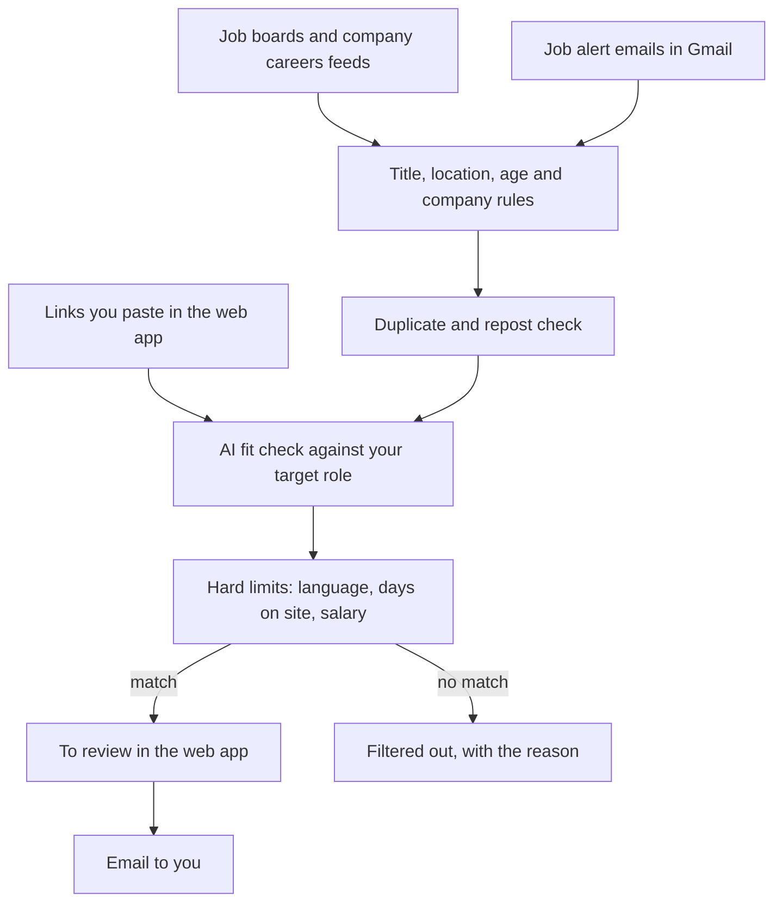

# Job application bot

A personal job search assistant that runs on a small server.
Every 30 minutes during the day it collects new postings from several sources, removes duplicates and reposts, and asks an AI model whether each job fits the role you described.
It emails you new matches, and a small web app lets you track each application, add jobs by pasting a link, and keep a copy of every posting in case it is taken down.

You review every job and apply yourself.
The bot never applies, never messages anyone, and only ever emails you.

## How it works



1. **Collect.** Sources are switched on in your profile: Arbeitnow, Berlin Startup Jobs, JSearch (Google for Jobs), public careers feeds of a list of companies, and the job alert emails LinkedIn, Indeed, StepStone and XING send to your Gmail.
2. **Rules.** Cheap checks keep jobs whose title matches your patterns, in your area or remote, and recent enough.
3. **Duplicates.** The same job often appears on several sites. Exact matches merge automatically, and likely reposts are confirmed by the AI. A duplicate adds its link to the original and never sends a second email.
4. **Fit check.** The AI reads the posting and your target role document, and returns a decision, a fit score, reasons, gaps and unknowns.
5. **Hard limits.** Code, not the AI, enforces your limits on what the AI extracted, such as a language requirement or a salary floor.
6. **Notify and track.** Matches are emailed to you and appear in the web app, where you mark each one applied, interviewing, rejected or not interested.

## Boundaries

These are built in and should stay that way:

- The bot never visits or automates LinkedIn, Indeed, StepStone, XING or other sites whose terms prohibit it. It reads only the alert emails those sites send you, and for pasted links from them it asks you to paste the job text.
- It never fakes its identity, solves CAPTCHAs or evades bot detection, and it backs off when a site asks it to slow down.
- It sends email only to the owner address in your profile, and never replies to anyone.
- Job postings and emails are untrusted text. AI calls return JSON in a fixed schema with no tools, so a posting cannot make the bot act.
- The web app fetches a pasted link only if it resolves to a public address, checked again on every redirect.

## Setup

You need Python 3.12 or newer, an OpenAI API key, and a Google account for Gmail.
A server is optional for trying it out, but needed to run it on a schedule.

### 1. Install and create your profile

```bash
python3.12 -m venv .venv && .venv/bin/pip install -r requirements.txt
cp -r profile.example profile
```

- `profile/settings.toml` holds your owner email, timezone, search area, title patterns, limits and sources. Every setting is explained in the file.
- `profile/target_role.md` describes the job you want, your background, your gaps and the screening rules. The AI reads all of it for every fit check, so specific is better.

Git ignores `profile/`, so your details never end up in the repository.

### 2. Keys

```bash
cp .env.example .env
```

Fill in `OPENAI_KEY`, and optionally `JSEARCH_API_KEY` from [OpenWeb Ninja](https://www.openwebninja.com/api/jsearch).

### 3. Gmail access

The bot uses Gmail to read job alerts and to email you, through your own Google Cloud project.

1. Create a project in the [Google Cloud console](https://console.cloud.google.com/) and enable the Gmail API.
2. Under **Google Auth Platform**, set up the consent screen as an external app, and add the scopes `gmail.readonly` and `gmail.send`.
3. Create an OAuth client of type **Desktop app** and save its JSON as `.secrets/google_client.json`.
4. Publish the app to production. In testing mode Google expires the approval after 7 days. Publishing asks for a home page and privacy policy URL, and a simple GitHub Pages site works. The app stays unverified, which is fine for your own account: you click through one warning when you approve it.
5. Run `PYTHONPATH=src .venv/bin/python -m jobbot auth` on your own computer and approve access in the browser. This saves `.secrets/google_token.json`.

### 4. Company list (optional)

`config/companies-berlin.csv` lists Berlin employers with public careers feeds on Greenhouse, Ashby, Lever, SmartRecruiters, Recruitee and Personio.
To search another city, create a CSV with the columns `company,ats,slug` and point `companies_file` in your profile to it.
The `slug` is the company's name in its careers system, for example `n26` in `boards.greenhouse.io/n26`.

### 5. Try it

```bash
PYTHONPATH=src .venv/bin/python -m jobbot run --dry-run   # Public sources and rules only: no AI, email or saved state
PYTHONPATH=src .venv/bin/python -m jobbot run --force     # One full run, outside active hours too
PYTHONPATH=src .venv/bin/python -m jobbot web             # The web app on http://127.0.0.1:8090
```

### 6. Deploy to a server

`deploy/deploy.sh` installs the bot on an Ubuntu server that has sudo, nginx and certbot.
Set `DEPLOY_HOST` in `.env`, then run:

```bash
./deploy/deploy.sh     # Copy code, profile and secrets, schedule the runs, and serve the web app over HTTPS
./deploy/run-now.sh    # Run one search now
./deploy/status.sh     # Check what is installed and what the bot last did
```

The first deploy generates a web app password in `.env`, and uses a free [sslip.io](https://sslip.io) hostname made from the server's IP unless you set `APP_HOSTNAME`.
It leaves other apps' crontab entries and nginx sites untouched.
The bot uses about 20 MB of memory for the web app, plus a short burst during each run.

## Project layout

| Path | Contents |
|---|---|
| `src/jobbot/cli.py` | Commands: `auth`, `run`, `web` |
| `src/jobbot/pipeline.py` | One run: collect, rules, duplicates, AI check, email |
| `src/jobbot/sources/` | Job sources, plus pasted links in `manual.py` |
| `src/jobbot/filters.py` | Rules and hard limits from the profile |
| `src/jobbot/ai.py` | OpenAI calls with fixed JSON schemas |
| `src/jobbot/store.py` | SQLite storage |
| `src/jobbot/web.py` | The tracker web app, using only the Python standard library |
| `src/jobbot/notify.py` | The email |
| `profile.example/` | An example profile to copy |
| `config/` | Company lists for careers feeds |
| `deploy/` | Server install and helper scripts |

## Development

```bash
.venv/bin/python -m unittest discover -s tests
```

Tests run against `profile.example/`, so they don't depend on your own profile.
The only third-party runtime dependency is `requests`, and keeping it that way keeps the bot small enough for a free cloud server.

Contributions are welcome, especially new job sources, company lists for other cities, and better duplicate detection.
A new source should use an official API, public feed or emails the user receives, and must respect the boundaries above.

## License

MIT, see [LICENSE](LICENSE).
